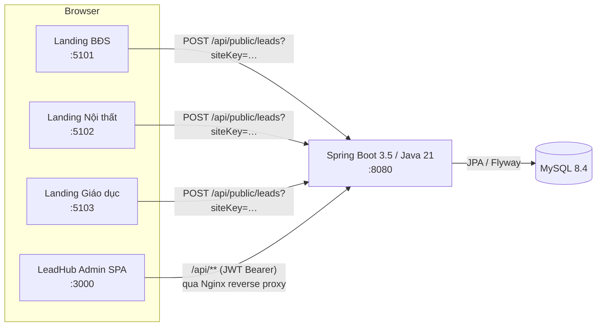
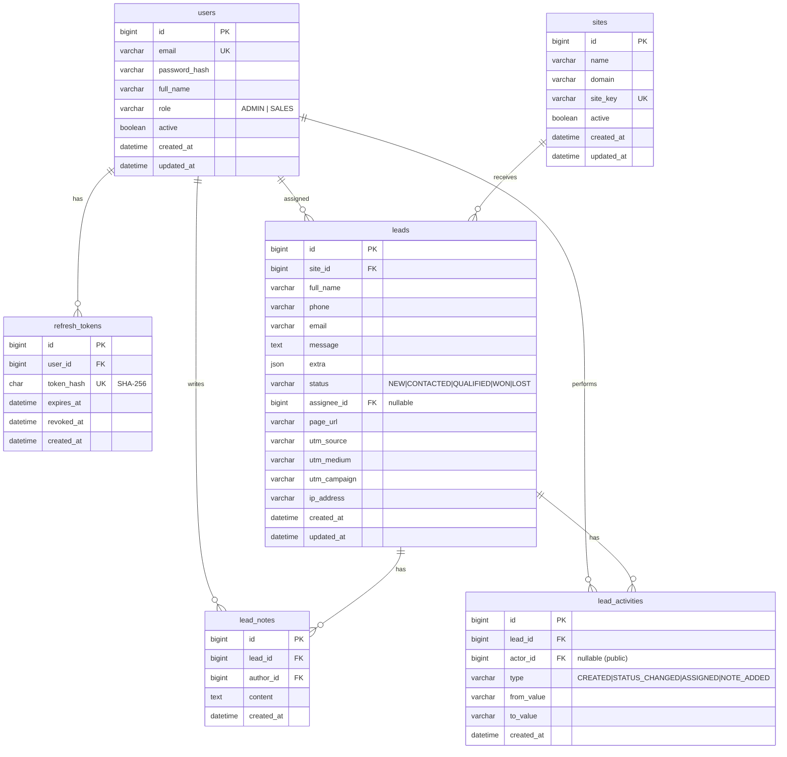

# ARCHITECTURE — LeadHub

> Vai trò: Solution Architect

## 1. Tổng quan



- **Kiến trúc:** monolith phân lớp theo module nghiệp vụ (package-by-feature). Mỗi module gồm `controller → service → repository`. DTO được map bằng MapStruct.
- **Stateless:** xác thực bằng JWT, không giữ session phía server. Refresh token được lưu (dạng băm SHA-256) trong DB để có thể thu hồi.
- **Frontend admin:** SPA React, được Nginx phục vụ. Nginx proxy `/api` sang backend, nên admin và API chung origin và không cần CORS.
- **Landing:** site tĩnh, gọi API public khác origin. Chỉ đường `/api/public/**` mở CORS.

## 2. ERD



Index: `leads(status)`, `leads(site_id, created_at)`, `leads(assignee_id)`, `leads(created_at)`, `leads(phone)`.

## 3. API

Base path `/api`. Tài liệu OpenAPI ở `/swagger-ui.html`. Lỗi trả về theo định dạng thống nhất:

```json
{ "status": 400, "error": "VALIDATION_ERROR", "message": "Dữ liệu không hợp lệ", "fieldErrors": { "phone": "Số điện thoại không hợp lệ" }, "timestamp": "…" }
```

| Method | Path | Quyền | Mô tả |
| --- | --- | --- | --- |
| POST | `/public/leads?siteKey=` | Public (rate limit 10/phút/IP) | Nhận lead từ landing. Body JSON tự do; đọc `name`, `phone`, `email`, `message`, `utm_*`, `page`, còn lại vào `extra`; honeypot `website` |
| POST | `/auth/login` | Public | `{email, password}` → `{accessToken, refreshToken, expiresIn, user}` |
| POST | `/auth/refresh` | Public | `{refreshToken}` → cặp token mới (rotation: token cũ bị thu hồi) |
| POST | `/auth/logout` | Public | `{refreshToken}` → thu hồi |
| GET | `/auth/me` | Đã đăng nhập | Thông tin người dùng hiện tại |
| GET | `/leads` | ADMIN, SALES* | Lọc: `status, siteId, assigneeId, unassigned, q, from, to, page, size, sort` |
| GET | `/leads/export` | ADMIN | CSV theo bộ lọc |
| GET | `/leads/{id}` | ADMIN, SALES* | Chi tiết |
| PATCH | `/leads/{id}` | ADMIN, SALES* | `{status?, assigneeId?}` |
| POST | `/leads/{id}/claim` | SALES, ADMIN | Nhận lead chưa giao |
| GET | `/leads/{id}/notes` | ADMIN, SALES* | Danh sách ghi chú |
| POST | `/leads/{id}/notes` | ADMIN, SALES* | `{content}` |
| GET | `/leads/{id}/activities` | ADMIN, SALES* | Lịch sử |
| GET | `/dashboard/stats` | ADMIN, SALES* | Tổng quan |
| GET | `/sites` | ADMIN (SALES: chỉ id+name) | Danh sách landing, có số lead |
| POST | `/sites` | ADMIN | Tạo |
| PUT | `/sites/{id}` | ADMIN | Sửa tên, domain, active |
| POST | `/sites/{id}/regenerate-key` | ADMIN | Tạo key mới |
| GET | `/users` | ADMIN | Danh sách; `?role=SALES&active=true` |
| GET | `/users/assignees` | ADMIN, SALES | Danh sách rút gọn người có thể được giao |
| POST | `/users` | ADMIN | Tạo |
| PUT | `/users/{id}` | ADMIN | Sửa tên, vai trò, active (không tự khoá mình) |

\* **Phạm vi dữ liệu của SALES:** chỉ lead có `assignee_id = mình` hoặc `assignee_id IS NULL`. Lead ngoài phạm vi trả về 404 (không lộ sự tồn tại). SALES không được đặt `assigneeId` sang người khác.

## 4. Phân quyền

| Tài nguyên | ADMIN | SALES | Public |
| --- | --- | --- | --- |
| Gửi lead | – | – | ✔ (cần siteKey) |
| Xem/sửa lead | Tất cả | Của mình + chưa giao | – |
| Giao lead cho người khác | ✔ | ✘ (chỉ nhận cho mình) | – |
| Ghi chú | ✔ | Trong phạm vi | – |
| Xuất CSV | ✔ | ✘ | – |
| Dashboard | Toàn hệ thống | Phạm vi của mình | – |
| Sites | CRUD | Đọc tên | – |
| Users | CRUD | ✘ | – |

Cơ chế:
- `SecurityFilterChain` + `JwtAuthenticationFilter`, quyền theo URL ở bộ lọc và `@PreAuthorize` ở controller.
- Phạm vi dữ liệu được kiểm tra trong `LeadService` (bằng `Specification` thêm điều kiện theo người dùng hiện tại).

## 5. Bảo mật

- Mật khẩu băm BCrypt (cost 10). JWT HS256, secret ≥ 32 byte lấy từ biến môi trường `JWT_SECRET`; khi khởi động, độ dài secret được kiểm tra.
- Access token 15 phút. Refresh token 7 ngày, là chuỗi ngẫu nhiên 256-bit, DB chỉ lưu băm SHA-256, mỗi lần refresh thì token xoay vòng (rotation).
- Truy vấn chỉ dùng JPA, Criteria và tham số bind, không nối chuỗi SQL. Tìm kiếm `q` có escape ký tự `%` và `_`.
- Validation bằng Jakarta Bean Validation ở DTO, giới hạn độ dài mọi trường. `extra` tối đa 20 khoá, mỗi giá trị tối đa 500 ký tự. Body tối đa 16KB.
- Rate limit bằng bộ đếm cửa sổ trượt in-memory theo IP cho `/api/public/**` và `/api/auth/login`.
- CSV export chống CSV injection: ô bắt đầu bằng `= + - @` được thêm tiền tố `'`.
- Header bảo mật được đặt ở Nginx (CSP, X-Content-Type-Options, Referrer-Policy) và Spring (frame-options deny).
- Không log mật khẩu hay token. `.env` nằm trong `.gitignore`, chỉ commit `.env.example`.

## 6. Cấu trúc thư mục

```
.
├── apps/
│   ├── admin/                 # LeadHub Admin (React + Vite + TS + Tailwind + React Query + RHF + Zod)
│   │   ├── src/{api,components,features/{auth,dashboard,leads,sites,users},lib,routes}
│   │   └── e2e/               # Playwright e2e
│   ├── real-estate/ interior/ education/   # 3 landing (đã có)
├── backend/                   # Spring Boot (Maven)
│   ├── src/main/java/vn/leadhub/
│   │   ├── auth/  user/  site/  lead/  dashboard/
│   │   ├── security/          # JWT, filter, rate limit, current user
│   │   ├── common/            # lỗi, exception handler, PageResponse
│   │   └── config/            # Security, OpenAPI, CORS, seed
│   ├── src/main/resources/db/migration/   # Flyway
│   └── src/test/java/…        # unit (Mockito) + integration (Testcontainers MySQL)
├── docker/                    # Dockerfile frontend, nginx conf
├── docker-compose.yml
├── .env.example
├── .github/workflows/ci.yml
└── docs/
```

## 7. Triển khai

- `docker compose up -d --build` dựng toàn bộ: `mysql`, `backend`, `admin` (nginx :3000), `landing-real-estate` (:5101), `landing-interior` (:5102), `landing-education` (:5103).
- Mỗi landing được build với `VITE_LEAD_ENDPOINT=http://localhost:8080/api/public/leads?siteKey=<key demo>`.
- Seed demo (`APP_SEED_DEMO=true`) tạo 3 site với site key cố định, 4 tài khoản và khoảng 60 lead tiếng Việt.
- Production: đặt `JWT_SECRET`, mật khẩu DB, `APP_CORS_PUBLIC_ORIGINS` và tắt seed demo.
